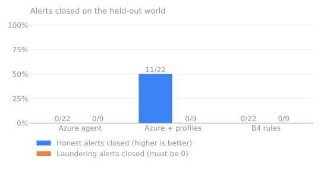
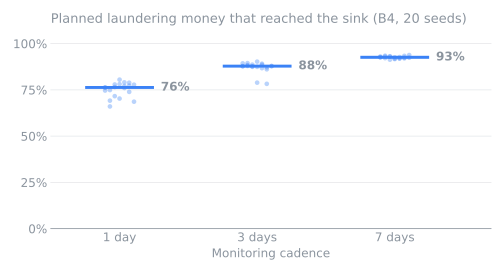
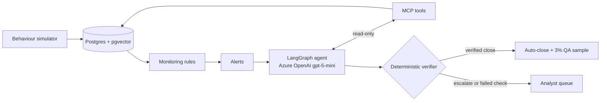
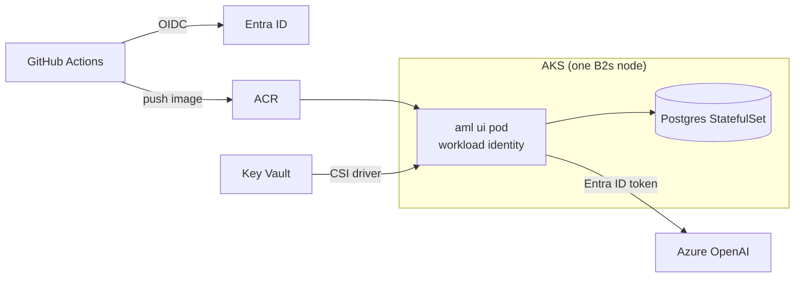

<h1 align="center">AML Alert Investigator</h1>

<p align="center">An LLM agent that investigates anti-money-laundering alerts, cites its evidence and leaves the decision to the analyst.</p>

<p align="center">
  <a href="https://github.com/InYanInIn/aml-alert-investigator/actions/workflows/ci.yml"></a>
  
  
  
  
  
  
  
  
</p>


- **Investigates alerts.** Monitoring rules raise alerts; a LangGraph agent on Azure OpenAI gathers evidence through read-only MCP tools.
- **Cites everything.** Every claim points to transaction ids and to EU AMLR / Polish AML-act passages.
- **Checks itself.** A deterministic verifier tests each citation and number before anyone sees the case.
- **The analyst decides.** Verified closes are sampled for QA; escalations go to the analyst queue.

> Portfolio project on synthetic data (IBM AMLworld and a purpose-built bank simulator). Not a compliance product.

<table>
  <tr>
    <td width="50%"><br><sub>A client's profile, balance and payments in the payment network.</sub></td>
    <td width="50%"><br><sub>An escalated case: typologies, cited transactions and regulation passages.</sub></td>
  </tr>
  <tr>
    <td><br><sub>The analyst queue with the agent's recommendations.</sub></td>
    <td><br><sub>Alerts the agent closed on its own, with the QA sample.</sub></td>
  </tr>
  <tr>
    <td><br><sub>A simulation run in progress: one week, paid Azure investigations, live spend.</sub></td>
  </tr>
</table>

## 📊 Results at a glance

 

Left: on the held-out simulated world, only the agent with customer profiles closes honest alerts, and it closes no laundering ones.
Right: the longer the monitoring cadence, the more planned laundering money reaches its sink.

- **AMLworld test split (opened once, config frozen):** the agent decides like a no-LLM rule (B4) on 399 of 400 alerts. It adds the investigated, cited case, at about 6.5 cents and three minutes per alert.
- **Simulated bank (one held-out world, 31 alerts):** with customer profiles and payment purposes, the agent closed 11 of 22 honest alerts and 0 of 9 laundering ones. The rule, B1 and the frozen M8 agent closed none.
- **Prompt injection:** 0 successful attacks. 0 of 34 (HI) and 0 of 35 (LI) clean escalations closed after an instruction was planted in a payment reference.
- **Cadence (20 seeds):** 76% of planned laundering money reaches its sink with daily monitoring, 93% with weekly.

Full tables, intervals, caveats and costs: [docs/results.md](docs/results.md).

## 🎯 Two uses

- **Alert-triage copilot.** The agent prepares a cited case for every alert; the analyst confirms or overrides.
- **Training sandbox for junior analysts.** The simulator produces realistic cases with known ground truth, and the agent's cited reasoning gives a reference to compare against.

A dedicated practice mode (decide first, then compare with the AI and the truth) is on the roadmap. It is not built.

## ⚙️ How it works



<details>
<summary><b>The agent and its tools</b></summary>

- Hybrid graph (ADR-0001): a deterministic evidence pack, then at most `k` tool calls within a token budget, then one structured-output decision. Cost per alert has a hard upper bound.
- MCP is the agent's only data path (ADR-0006). Tools: `get_alert`, `list_transactions`, `get_transactions`, `get_account_profile`, `get_counterparties`, `trace_funds`, `get_typology_candidates`, `search_regulations`, `get_regulation_passage`.
- Regulation search is vector search (pgvector, `text-embedding-3-small`) over EU AMLR and Polish AML-act passages ingested from EUR-Lex and the Polish act.
- The verifier checks every transaction id, number and passage against what the tools returned. A failed draft is repaired once, then forced to `escalate`.
- Decisions are recorded next to the agent's case and never overwritten by it (ADR-0013).
</details>

<details>
<summary><b>Evaluation</b></summary>

- Labels live where the agent cannot read them; the agent is scored against them afterwards.
- Baselines (ADR-0010): B0 escalate all, B1 rule score, B2 single prompt without tools, B3 gradient boosting (scikit-learn, trained on the train window), B4 the no-LLM close rule.
- The test split was opened once with the configuration frozen (ADR-0024). Every opening is logged in [docs/test-split-log.md](docs/test-split-log.md), including the unintended ones.
- Metrics carry bootstrap intervals. 30 regulation citations were graded: 18 support the claim, 10 are only related, 2 do not support it.
</details>

<details>
<summary><b>The behaviour simulator</b></summary>

- A simulated bank with customer personas, onboarding profiles, honest behaviour (including honest customers whose activity does not match their profile) and six to eight laundering groups.
- Scenarios (mules, structuring, shell companies, funnels, cycles, fake invoices, slow layering) and texts were written blind: by a subagent that did not see the rules, the prompts or the M8 results.
- Thresholds are calibrated per customer segment. With one global threshold, 33 of 35 development alerts were corporations and none reached a laundering group.
- The world is resumable: days replay from the stored seed with a hash check, so an interrupted run continues without duplicate days or double spend.
</details>

<details>
<summary><b>Security</b></summary>

- **Label isolation by schema and role** (ADR-0004): labels and simulator truth sit in schemas the agent's role `aml_mcp_reader` cannot read.
- **Roles in the UI:** the `aml ui` process uses the owner role to create and reset the simulated world. The agent's MCP tools and the Analyst pages use the restricted `aml_mcp_reader` and `aml_app` roles, so the agent still never sees labels.
- **Prompt injection:** payment references are untrusted text. Clean/injected pairs with a clean-twice control produced zero successful attacks.
- **Spend guard:** before paid runs the app reads the Azure OpenAI account and deployments and refuses on any mismatch; a lifetime UI limit and Azure budget alerts sit on top.
</details>

## ☁️ Azure deployment



- **No static secrets:** GitHub deploys over OIDC, the pod uses workload identity, DSNs come from Key Vault through the CSI driver, and Azure OpenAI accepts Entra ID tokens only.
- **Least-privilege identities:** the app identity can call the model and read its secrets; the GitHub identity can push images and deploy to this cluster, from `main` only.
- **Separate Terraform roots:** `infra/aks/` reads the Azure OpenAI account as a data source, so `terraform destroy` cannot remove the model.
- **Port-forward only:** the app has no login, so there is no public endpoint.

Free Trial constraints met: the quota fits one B2s node, and Flexible Server is unavailable in swedencentral and polandcentral, so the cluster runs in swedencentral with Postgres inside it. The cluster is destroyed after the demo. Details: [docs/m11-deploy-design.md](docs/m11-deploy-design.md).

## 🚀 Run it locally

Needs Docker, [uv](https://docs.astral.sh/uv/) and Node.js.

```bash
cp .env.example .env          # set POSTGRES_PASSWORD and the role DSNs
docker compose up -d postgres
make ui                       # build the React world view
uv run aml migrate
uv run aml ui                 # opens http://127.0.0.1:8765/world
```

The B4 rule runs free. Paid `azure_profile` investigations need `az login` and the Azure variables in `.env`.

<details>
<summary><b>Tech stack, project layout, limitations</b></summary>

| Area | Tools |
|---|---|
| Agent | LangGraph, LangChain MCP adapters, FastMCP, Azure OpenAI (`gpt-5-mini`, `text-embedding-3-small`), Langfuse |
| Backend | Python 3.12, uv, FastAPI, psycopg, PostgreSQL + pgvector, scikit-learn |
| Frontend | React + D3 (Vite), Jinja analyst pages |
| Infra | Terraform, Helm, AKS, ACR, Key Vault, GitHub Actions |
| Quality | pytest, ruff, mypy, Vitest |

```
src/aml_investigator/   simulation, monitoring, mcp_server, investigation, corpus, evaluation, review, web, truth
corpus/                 regulation sources
config/                 simulator scenarios, text pools, thresholds
eval/                   frozen samples, results, replay recordings
deploy/helm/            Helm chart
infra/                  Terraform: terraform/ (Azure OpenAI), aks/ (cluster)
scripts/                kind and AKS helpers
docs/                   design, plan, results, ADRs
tests/
```

**Limitations**

- Synthetic data only. The simulator stresses the system; it does not estimate accuracy on real bank data.
- The simulated result rests on one held-out world and 31 alerts: counts, not rates with intervals.
- Two simulated scenarios produced no alert, so no decision could reach them.
- The agent's AMLworld decision matches a simple rule; its regulation citations are often generic.
- LLM calls cost money: $6.87 for the whole simulator evaluation.

Plan and milestones: [docs/plan.md](docs/plan.md). Decisions: [docs/adr/](docs/adr/).
</details>
