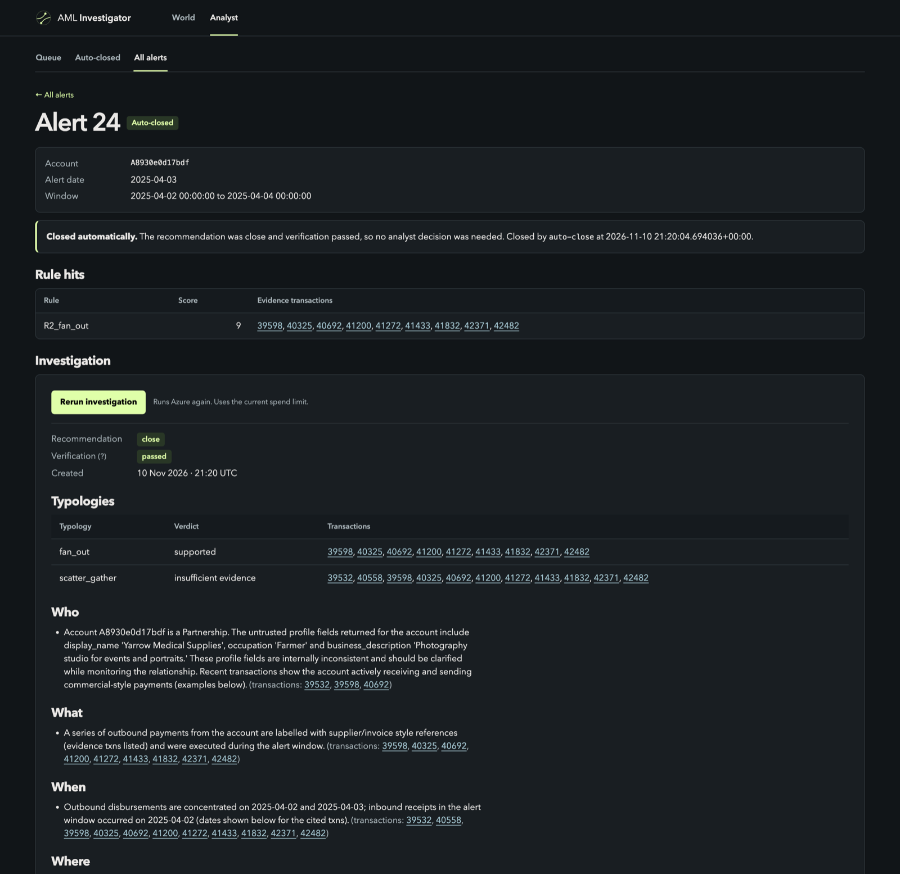
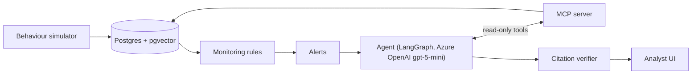

# AML Alert Investigator

An LLM agent that prepares anti-money-laundering alert investigations for a human analyst. Monitoring rules raise
alerts; the agent gathers evidence through read-only MCP tools, tests the alert against laundering typologies, cites
the transactions and the EU AMLR / Polish AML-law passages behind every claim, and a deterministic verifier checks each
citation before the analyst sees the case. The analyst confirms or overrides. The agent is evaluated against labels it
never sees and against non-LLM baselines, and the results below include the ones that do not flatter it.

Portfolio project on synthetic data (IBM AMLworld and a purpose-built simulator). Not a compliance product.

## Screenshots




## What it does

1. **Monitoring rules** raise alerts over transactions (thresholds per customer segment, calibrated to an alert budget).
2. **The agent** (LangGraph, bounded tool loop, Azure OpenAI `gpt-5-mini`) investigates through an MCP server that
   exposes read-only tools over transactions, accounts, customer profiles and a regulation search.
3. **Every claim is cited**: transaction ids and passages from the EU AMLR and the Polish AML act (vector search over a
   corpus ingested from EUR-Lex and the Polish act).
4. **A deterministic verifier** checks each citation and each number against what the tools returned; a failed draft is
   repaired once, then forced to `escalate`.
5. **Auto-close with QA sampling** (ADR-0017): low-risk closes are sampled for human review.
6. **The analyst decides.** Decisions are recorded with the agent's case, never overwritten by it.

## Key results

Full tables, intervals and sources: [docs/results.md](docs/results.md).

**M8, IBM AMLworld test split (opened once, config frozen beforehand).** The agent's close/escalate decision is the
decision of a no-LLM rule (B4): they agree on 399 of 400 test alerts (200 HI-Small, 199 of 200 LI-Small), and the one
difference is a close that failed citation verification. What the agent adds is the investigated, cited case, at about
6.5 cents and three minutes per alert. Of 30 graded regulation citations, 18 support the claim, 10 are only related and
2 do not support it; the agent leans on generic passages for close decisions. Prompt-injection pairs: 0 of 34 (HI) and
0 of 35 (LI) clean escalations closed after an instruction was planted in a payment reference.

**M9, behaviour simulator (held-out world, opened once, one seed, 31 alerts).** AMLworld's close policy does not
transfer to ordinary customers: the frozen M8 agent, B4 and B1 closed none of the 31 alerts. With customer profiles and
payment purposes the agent (`azure_profile`) closed 11 of 22 honest alerts and 0 of 9 laundering ones, raising
escalation precision to 45% against 29%. Detection did not change (5 of 7 laundering groups found by every system); the
gain is analyst workload. It failed citation verification on 4 of 31 decisions, the frozen agent on 1. Over 20 seeds,
a weekly monitoring cadence instead of daily lets 93% of planned laundering money reach its sink against 76%.

Caveats: one world and 31 alerts mean counts, not rates with intervals; the simulator stresses the system, it does not
estimate accuracy on real bank data.

## Architecture



- `simulation/` simulated bank: customer personas, honest behaviour, laundering scenarios, daily loop
- `monitoring/` rules, per-segment thresholds, alerts
- `mcp_server/` the only data path of the agent (ADR-0006)
- `investigation/` agent graph, decision model, verifier, routing
- `corpus/` EU AMLR and Polish AML-law passages, embeddings, search
- `evaluation/` baselines B0-B4, metrics with bootstrap intervals, injection pairs, replay recordings
- `review/` analyst decisions; `web/` FastAPI app, React + D3 world view, Jinja analyst pages
- `truth/` ground-truth labels, kept apart from everything the agent can read

## Security and engineering

- **Label isolation by schema and role** (ADR-0004): labels and simulator truth live in schemas the agent's database
  role cannot read.
- **Prompt injection**: payment references are untrusted text; clean/injected pairs with a clean-twice control produced
  zero successful attacks.
- **No static secrets on Azure**: workload identity for the pod, Key Vault secrets mounted through the CSI driver,
  GitHub Actions deploys over OIDC. The Azure OpenAI account accepts Entra ID tokens only.
- **Spend guard**: model calls are bounded by a budget check that reads the account and deployments before paid runs;
  Azure budget alerts sit on top.
- **Evaluation discipline**: the test split was opened once with a frozen configuration, and every opening is logged in
  [docs/test-split-log.md](docs/test-split-log.md), including the unintended ones.
- **Decisions are written down**: 26 ADRs in [docs/adr/](docs/adr/).

## Deployment

Locally everything runs from one command (needs Docker for Postgres and a migrated database; the world view and the
analyst desk open in the browser):

```bash
uv run aml ui
```

Azure: AKS on a Free Trial subscription in swedencentral, provisioned with Terraform and deployed from GitHub Actions.
Postgres runs in the cluster because Flexible Server was unavailable on the subscription. There is no public endpoint
(the app has no login); the demo is reached by `kubectl port-forward` only, and `terraform destroy` removes
everything afterwards. Steps, costs and cut-offs: [docs/m11-deploy-design.md](docs/m11-deploy-design.md). A local
Kubernetes variant (kind, same Helm chart) is in ADR-0020.

Agent runs on Azure OpenAI need `az login` and the endpoint in `.env`:

```bash
uv run aml --database aml_hi_small corpus embed
uv run aml --database aml_hi_small eval run --system azure --split val --limit 10 --concurrency 2 --record
```

## Tech stack

Python 3.12, uv, FastAPI, LangGraph, LangChain MCP adapters, FastMCP, PostgreSQL with pgvector, psycopg, Azure OpenAI
(`gpt-5-mini`, `text-embedding-3-small`), Langfuse tracing, React + D3 (Vite), Terraform, Helm, AKS, GitHub Actions,
pytest.

## Project layout

```
src/aml_investigator/   application code (modules above)
corpus/                 regulation sources
eval/                   frozen samples, results, replay recordings
deploy/helm/            Helm chart
infra/                  Terraform (Azure resources, AKS)
scripts/                kind and AKS helpers
docs/                   design, plan, results, ADRs
tests/
```

## Limitations

- Synthetic data only; AMLworld's laundering patterns are generated, and its payment references are synthetic and
  independent of the labels by construction.
- The agent's decision matches a simple rule; its value is the cited case, and its regulation citations are often
  generic.
- The simulator result rests on one held-out world and 31 alerts.
- Two simulated scenarios produced no alert, so no decision could reach them.
- LLM evaluation on LI-Small validation and stability repeats on test were not run.

## More

Plan and milestones: [docs/plan.md](docs/plan.md). Design: [docs/design.md](docs/design.md). Decisions:
[docs/adr/](docs/adr/). Data findings: [docs/data-notes.md](docs/data-notes.md).
