<h1 align="center">AML Alert Investigator</h1>

<p align="center">
  <b>An AI agent that investigates anti-money-laundering alerts, cites every piece of evidence<br>and leaves the decision to a human analyst.</b>
</p>

<p align="center">
  <a href="https://github.com/InYanInIn/aml-alert-investigator/actions/workflows/ci.yml"></a>   
    
</p>

<p align="center">
  <a href="#-part-1--evaluation-on-ibm-amlworld">AMLworld results</a> · <a href="#-part-2--the-behaviour-simulator">Simulator</a> · <a href="#%EF%B8%8F-the-analyst-app">Analyst app</a> · <a href="#-run-it-locally">Run it</a> · <a href="docs/results.md">Full results</a>
</p>

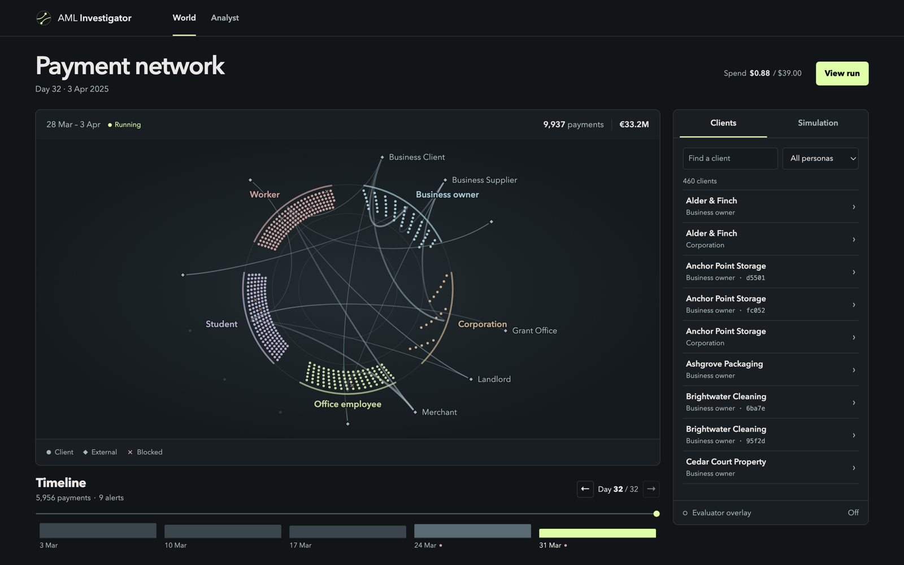

- 🔎 **Investigates** — monitoring rules raise alerts; a LangGraph agent gathers evidence through read-only MCP tools.
- 📎 **Cites** — every claim points to transaction ids and to EU AMLR or Polish AML-act passages.
- ✅ **Checks itself** — a deterministic verifier tests each citation and number before anyone sees the case.
- 🧑‍⚖️ **Defers** — verified closes are sampled for QA; escalations go to the analyst queue.

> [!NOTE]
> Portfolio project on synthetic data only: IBM AMLworld and a purpose-built bank simulator. Not a compliance product.

<table>
  <tr><td width="50%">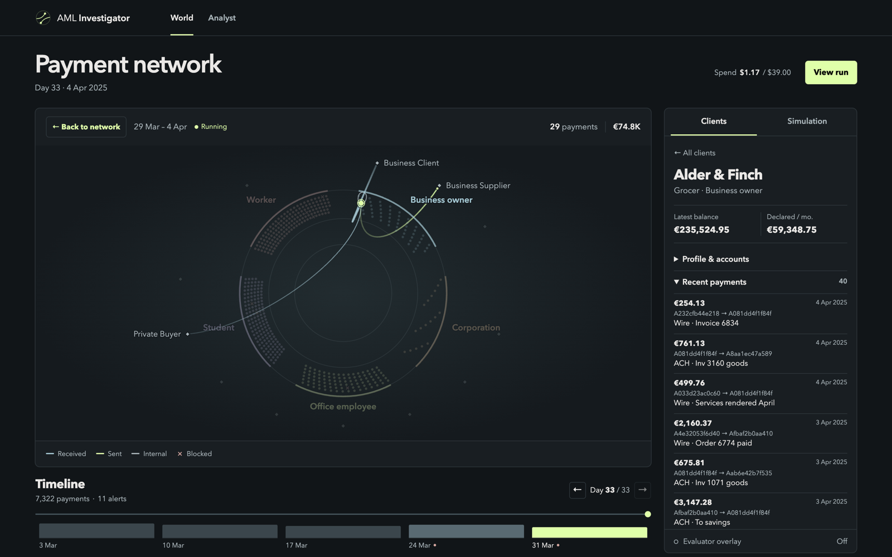<br><sub><b>Client</b> — profile, balance and payments in the network.</sub></td><td width="50%">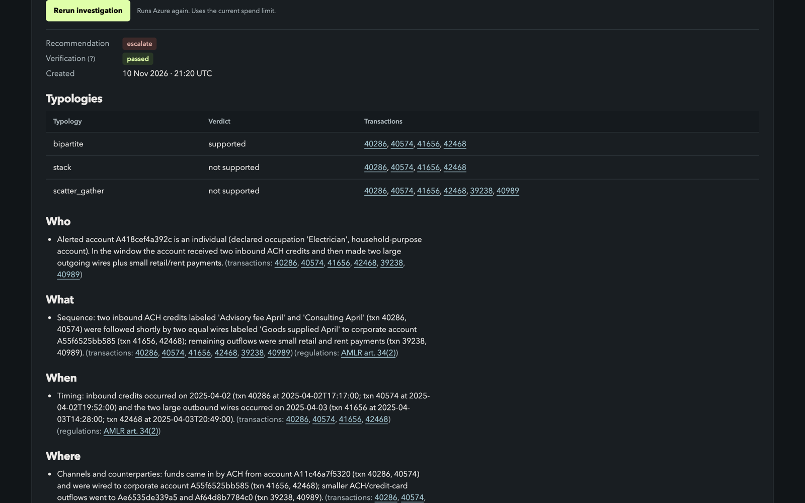<br><sub><b>Case</b> — typologies, cited transactions and law passages.</sub></td></tr>
  <tr><td>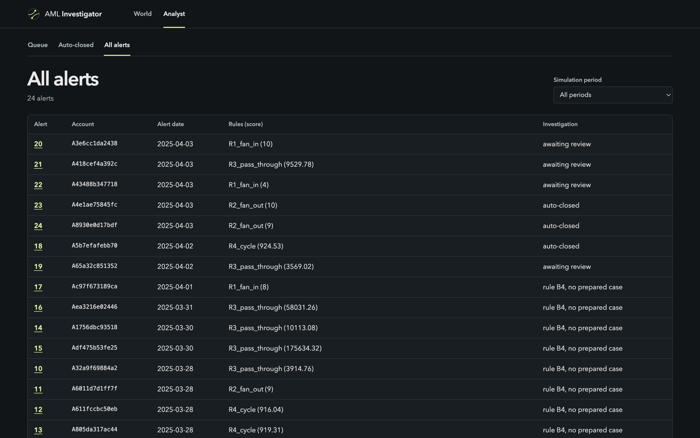<br><sub><b>Queue</b> — the agent's recommendations, waiting for the analyst.</sub></td><td>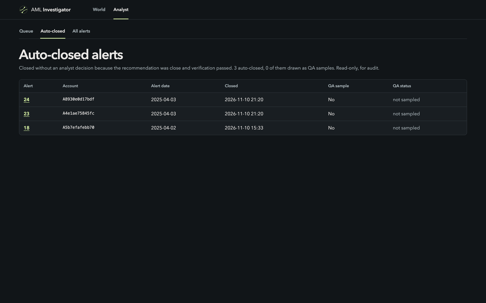<br><sub><b>Auto-closed</b> — alerts the agent closed, with the QA sample.</sub></td></tr>
</table>

The project has **two separate experiments**: an evaluation on a public dataset, and a simulated bank built to test what that dataset cannot.

---

## 📊 Part 1 — Evaluation on IBM AMLworld

**The dataset.** IBM AMLworld (NeurIPS 2023) is a synthetic transaction set with laundering labels.
Two variants are used: **HI-Small** (higher illicit share, used for development) and **LI-Small** (lower share, reported alongside).

| Method | What happened |
|---|---|
| Iterate | Prompt and settings tuned on the **validation** window only |
| Freeze | Configuration frozen: prompt v3, `gpt-5-mini`, at most 8 tool calls |
| Test once | 200 test alerts per dataset, opened once; every opening is logged in [test-split-log.md](docs/test-split-log.md) |
| Compare | Baselines **B0** escalate all · **B1** rule score · **B2** one prompt, no tools · **B3** gradient boosting · **B4** no-LLM close rule |

<picture><source media="(prefers-color-scheme: dark)" srcset="docs/images/results-amlworld-dark.png">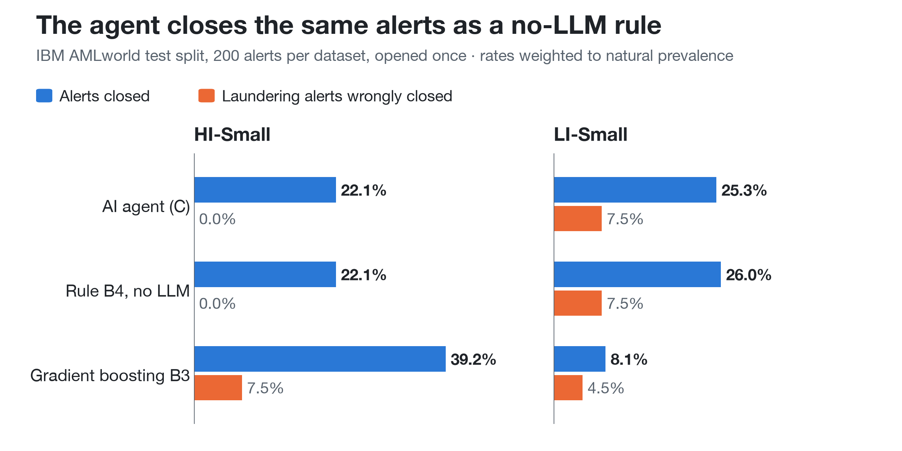</picture>

| Test split | Agent C | Rule B4 | Gradient boosting B3 |
|---|---|---|---|
| **HI-Small** closed · false-close | 22.1% · **0.0%** | 22.1% · 0.0% | 39.2% · 7.5% |
| **LI-Small** closed · false-close | 25.3% · 7.5% | 26.0% · 7.5% | 8.1% · 4.5% |

<sub>Close rate = alerts closed without an analyst. False-close rate = laundering alerts among them. Both weighted to natural prevalence; intervals in [results.md](docs/results.md).</sub>

> [!IMPORTANT]
> **The agent decides like a no-LLM rule.** C and B4 agree on **399 of 400** test alerts; the one difference is a close that failed citation checks.
> What the agent adds is the **investigated, cited case**, at about 6.5 cents and three minutes per alert.

- 🛡️ **Prompt injection: 0 successful attacks.** 0 of 34 (HI) and 0 of 35 (LI) clean escalations closed after an instruction was planted in a payment reference.
- 📚 **Citations: often generic.** Of 30 graded regulation citations, 18 support the claim, 10 are only related, 2 do not.

**Why a simulator next?** AMLworld has no payment purposes and no customer profiles, and ordinary people barely appear:
134 of about 166,000 entities are individuals, and they raise 20 of 16,991 alerts.

---

## 🏦 Part 2 — The behaviour simulator

**The question:** given information a rule cannot use — what each customer told the bank and why each payment was made — does an LLM decide better than the rule?

The simulator runs a small bank **one day at a time**: about 850 accounts, 21 days of history, then 28 live days.

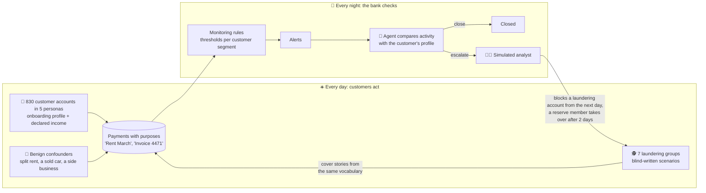

**The customers** (`config/simulation/personas.yaml`). Honest activity sometimes does not match the profile (15% of customers), so a mismatch is never a label.

| Persona | Accounts | Declared monthly (EUR) | Normal money flows | Honest surprises |
|---|---|---|---|---|
| 🎓 Student | 200 | 400–1,200 | stipend, family support, rent, card spending | sold a car, inheritance, tutoring |
| 🔧 Worker | 200 | 1,500–2,800 | wage, rent, bills, cash withdrawals | sold a car, weekend consulting |
| 💼 Office employee | 200 | 2,800–5,200 | salary, mortgage, card spending, savings | side-business income and costs |
| 🏪 Business owner | 150 | 15,000–60,000 | invoices in and out, tax, owner's drawings | large private sale |
| 🏢 Corporation | 80 | 150,000–900,000 | revenue, suppliers, payroll, tax | one-off asset disposal |

**The launderers** (`config/simulation/scenarios.yaml`), written blind, without access to the rules, prompts or earlier results:

| Scenario | Typology | Hides as | How the money moves | Held-out world |
|---|---|---|---|---|
| Student carriers | money mule | student | 3 payers send "family support"; 90% wired on | found in 2 days |
| Cash below threshold | structuring | worker | cash of 8,200–9,700 as "vehicle sale"; 90% to a company | found in 2 days |
| Consultant pass-through | shell company | office employee | "consulting invoices" of 15,000–40,000; 97% forwarded | found in 2 days |
| Many small cash deposits | funnel account | worker | rounds of 12 cash deposits of 200–900; 95% forwarded | found in 1 day |
| Round trip | cycle | two workers | money circles A → B → A, then leaves | found in 2 days |
| Supplier invoices | invoice disguise | office employee | "supplier invoices" of 4,000–9,000; 85% to 3 suppliers | ❌ no alert |
| Slow trickle | slow layering | student | four rounds of 300–700 "family support"; 80% passed on | ❌ no alert |

### Results on the held-out world (opened once, 31 alerts)

<picture><source media="(prefers-color-scheme: dark)" srcset="docs/images/results-simulator-dark.png">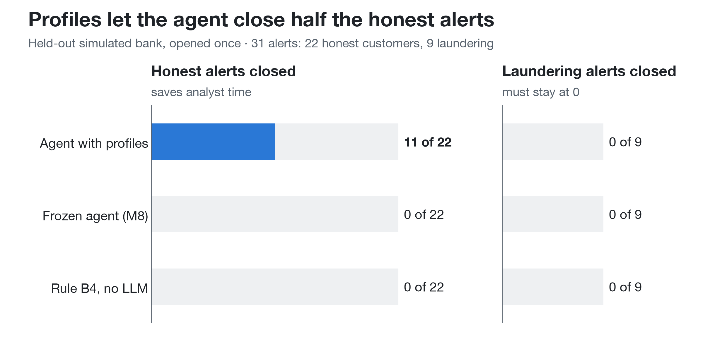</picture>

| System | Honest closed | Laundering closed | Escalation precision | Cost per alert |
|---|---|---|---|---|
| **Agent with profiles** | **11 of 22** | **0 of 9** | **45%** | $0.079 |
| Frozen agent from Part 1 | 0 of 22 | 0 of 9 | 29% | $0.066 |
| Rule B4 | 0 of 22 | 0 of 9 | 29% | free |

- 🎯 **The agent earns its place where it reads what a rule cannot**: half the honest alerts closed, no laundering let through.
- 🧱 **The Part 1 policy does not transfer**: it needs three or more sibling accounts, which ordinary customers rarely have.
- 🔍 **Detection did not change**: every system found 5 of 7 groups. The gain is analyst time, not more catches.
- ⚖️ **Per-segment thresholds matter**: with one global threshold, 33 of 35 development-world alerts were corporations and none hit a group.

<picture><source media="(prefers-color-scheme: dark)" srcset="docs/images/results-cadence-dark.png">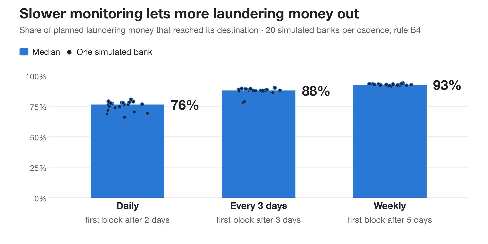</picture>

**Monitoring cadence** changes how much money leaves, not what is found: over 20 seeds the median stays at 5 groups found.

---

## 🖥️ The analyst app

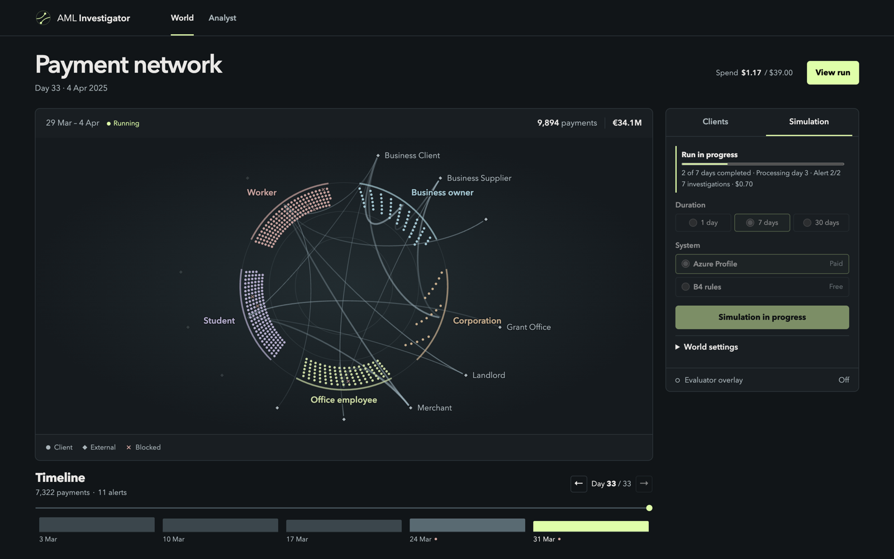

| Part | What it does |
|---|---|
| **World** | Clients, payment arcs and blocks; **Simulate** adds 1, 7 or 30 days with the agent or free rule B4 |
| **Analyst** | Queue, prepared cases, cited transactions and law passages, filtered by simulation period |
| **Spend guard** | Estimate before each run, a cap of 60 investigations, a lifetime limit of $39 |

- **Resumable:** days replay from the seed with a hash check, so an interrupted run never repeats a day or a payment.
- **God view:** `aml ui --evaluator` adds a toggle that outlines the laundering groups.

## ⚙️ How the agent works

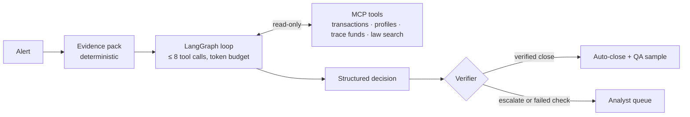

<details>
<summary><b>Details: tools, retrieval, verification</b></summary>

- **Bounded cost:** a fixed evidence pack, then at most `k` tool calls within a token budget, then one structured decision (ADR-0001).
- **One data path:** MCP is the agent's only access to data (ADR-0006): `get_alert`, `list_transactions`, `get_transactions`, `get_account_profile`, `get_counterparties`, `trace_funds`, `get_typology_candidates`, `search_regulations`, `get_regulation_passage`.
- **Verifier:** every transaction id, number and passage is checked against tool output; a failed draft is repaired once, then forced to escalate.
</details>

## 🔒 Security

| Risk | Control |
|---|---|
| Agent sees the labels | Labels and simulator truth live in schemas the agent's role `aml_mcp_reader` cannot read (ADR-0004) |
| Prompt injection | Payment references and profiles are untrusted text; injected/clean pairs with a clean-twice control |
| Runaway spend | The app checks the Azure OpenAI account and deployments before paid runs and refuses on any mismatch |
| Leaked secrets | No static secrets: OIDC for GitHub, workload identity for the pod, Key Vault for DSNs |

## ☁️ Azure deployment

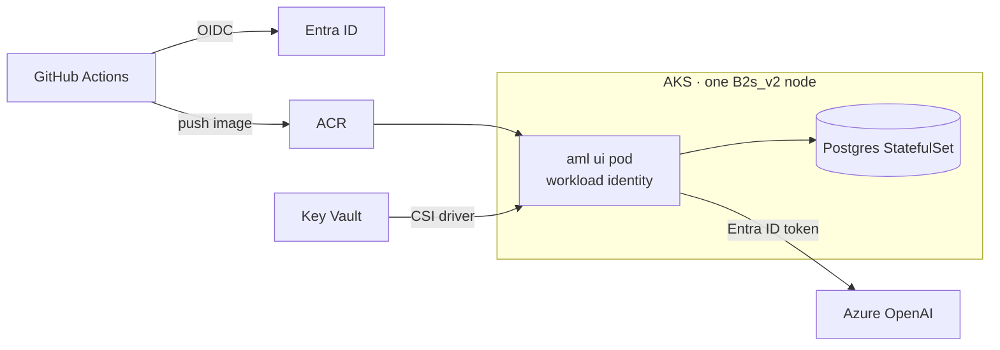

- **Least privilege:** the app identity can call the model and read its secrets; the GitHub identity deploys from `main` only.
- **Safe teardown:** `infra/aks/` reads the Azure OpenAI account as a data source, so `terraform destroy` cannot remove the model.
- **No public endpoint:** the app has no login, so it is reached by `kubectl port-forward` only.
- **Free Trial fit:** B2s nodes and Flexible Server were unavailable, so one B2s_v2 node in swedencentral runs Postgres too; the cluster is destroyed after the demo ([design](docs/m11-deploy-design.md)).

## 🚀 Run it locally

Needs Docker, [uv](https://docs.astral.sh/uv/) and Node.js.

```bash
cp .env.example .env          # set POSTGRES_PASSWORD and the role DSNs
docker compose up -d postgres
make ui                       # build the React world view
uv run aml migrate
uv run aml ui                 # opens http://127.0.0.1:8765/world
```

> [!TIP]
> Rule B4 runs free. Paid agent investigations need `az login` and the Azure variables in `.env`.

The tables in [docs/results.md](docs/results.md) are regenerated from the committed `eval/results/` by `aml eval report` and `aml sim report`.

## 🧰 Tech stack

| Area | Tools |
|---|---|
| Agent | LangGraph, FastMCP, Azure OpenAI `gpt-5-mini`, `text-embedding-3-small`, Langfuse |
| Backend | Python 3.12, uv, FastAPI, psycopg, PostgreSQL + pgvector, scikit-learn |
| Frontend | React + D3 (Vite), Jinja analyst pages |
| Infra | Terraform, Helm, AKS, ACR, Key Vault, GitHub Actions |
| Quality | pytest, ruff, mypy, Vitest |

