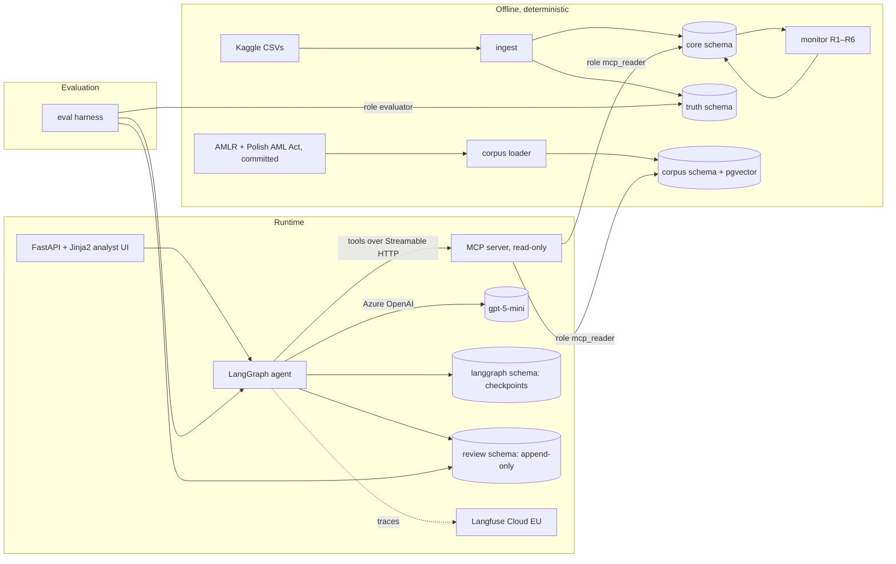
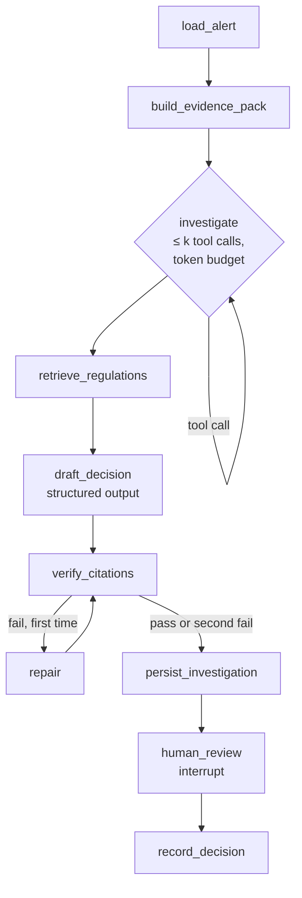

# AML Alert Investigator — Design

Status: draft for approval · 2026-10-28 · UI and docs in English; public repository (ADR-0014)

## 1. Context

Transaction-monitoring systems raise far more alerts than there is real laundering. An analyst triages each
alert by hand — account history, counterparties, money flows — and records a conclusion: close as a false
positive, or escalate for investigation and a possible suspicious-transaction report (STR).

The EU AML Regulation (EU) 2024/1624 (AMLR, applies from 10 July 2027) frames what that work must produce:

- **Art. 26** — monitoring checks transactions against what the institution knows of the customer, their
  business and risk profile, and the origin and destination of funds.
- **Art. 69(2)** — the institution assesses unusual activity against all relevant facts it holds.
- **Art. 77(1)(b)** — it keeps a record of every such assessment: the information and circumstances
  considered and the result, *whether or not* an STR follows. Art. 77(2) allows keeping references instead of
  copies only if the referenced information cannot be modified.
- **Art. 76(5)** — automated and AI-based decisions are permitted; decisions about the business relationship
  or the extent of due diligence require meaningful human intervention.

This project builds an agent that prepares that assessment for each alert and leaves the decision to the
analyst. It is a portfolio project on synthetic data; it is not a compliance product.

## 2. Goals and non-goals

Goals

1. For each alert, gather context through read-only tools, test it against laundering typologies, retrieve
   relevant regulation, and propose `close` or `escalate` with a structured rationale.
2. Every factual claim in the rationale cites a transaction ID or a regulation passage ID, and every citation
   is verified deterministically before an analyst sees it.
3. A verified `close` is final without a human; every `escalate` and a random 3% of auto-closures go to the
   analyst, who confirms or overrides (ADR-0017). Proposals and decisions are stored append-only.
4. An evaluation, designed before the agent, measures the agent against labels it never sees and against
   baselines including a non-LLM classifier — and reports the result as measured, including if a baseline wins.
5. Total cloud spend stays within the free Azure credit plus a $5 personal budget.

Non-goals

- Real customer data, KYC/CDD workflows, STR filing to an FIU, sanctions screening.
- Training or fine-tuning models; a GNN detector (the dataset authors already publish one).
- Multi-tenant auth, RBAC beyond a single analyst identity, a SPA frontend.
- High availability, autoscaling, a long-running cloud environment (AKS exists only for a recorded demo).
- A second cloud, Java, AWS/Bedrock.

## 3. Architecture



Components (one Python package, `aml_investigator`, managed with uv):

| Module | Responsibility |
|---|---|
| `ingest` | Load transactions, accounts, patterns; assign stable IDs; truncate the post-period tail; split labels into `truth`. |
| `monitor` | Rules R1–R6 as SQL; emit one alert per (account, day) with all rule hits. |
| `truth` | Derive alert-level ground truth from `truth.*`. Never imported by `mcp_server` or `agent`. |
| `corpus` | Parse the committed AMLR (EUR-Lex) and Polish AML Act (Sejm ELI) texts into article/paragraph passages; embed into pgvector. |
| `mcp_server` | Read-only MCP tools (section 6). The only path by which data reaches the model. |
| `agent` | LangGraph graph (section 5), structured decision schema, citation verifier. |
| `api` | FastAPI app: alert queue, alert detail, investigate, confirm/override. Server-rendered Jinja2. |
| `eval` | Splits, frozen samples, baselines B0–B3, metrics, reports. |

The model provider is reached through LangChain's chat-model interface. Production code uses
`AzureChatOpenAI`; tests use LangChain's fake chat model. No project-level provider abstraction.

## 4. Data model

One PostgreSQL 16 database, separated by schema and role.

```
core.accounts          (account_id PK, bank_id, bank_name, entity_id, entity_type)
core.transactions      (txn_id PK, ts, from_account, to_account, amount_paid, paid_currency,
                        amount_received, received_currency, payment_format, reference)
core.reference_injections (txn_id, injection_id, text)          -- used only in injection eval runs
core.alerts            (alert_id PK, account_id, alert_date, window_start, window_end, created_at)
core.alert_rule_hits   (alert_id, rule_id, score, evidence_txn_ids bigint[])

truth.transaction_labels (txn_id PK, is_laundering)
truth.pattern_attempts   (attempt_id, typology, txn_id)
truth.alert_truth        (alert_id PK, escalate_truth, escalate_truth_account_level, typologies text[])

corpus.documents       (doc_id PK, celex, title, version_date, source_url)
corpus.passages        (passage_id PK e.g. 'AMLR art. 77(1)(b)', 'PL-AML art. 74 ust. 1', doc_id, article, paragraph,
                        text, content_sha256, embedding vector(1536))

review.investigations  (investigation_id PK, alert_id, thread_id UNIQUE, run_id, model, prompt_version,
                        recommendation, typologies jsonb, rationale jsonb, citations jsonb,
                        verification jsonb, tool_calls int, input_tokens, output_tokens, cost_usd,
                        latency_ms, created_at)
review.decisions       (decision_id PK, investigation_id, analyst, final_decision, comment, decided_at)

langgraph.*            -- managed by langgraph-checkpoint-postgres
```

Rules that matter more than the columns:

- **Stable IDs.** The source CSV has no transaction ID. `txn_id` is assigned by ordering on
  `(ts, sha256(row), occurrence index)`, not file order, because file position predicts the label and exact
  duplicate rows exist (`docs/data-notes.md`).
- **Pseudonymised identifiers.** Account and entity IDs are salted hashes; source numbers predict the label
  (ADR-0015). `core.accounts` keeps bank, entity type and pseudonymised entity ID.
- **Post-period tail removed.** 59–60% of transactions after 2022-09-10 are laundering (measured); they are
  dropped at ingest.
- **`reference`** is a synthetic payment-reference field (ADR-0011), generated from a seeded RNG keyed on
  `txn_id` only — independent of the label.
- **Append-only review.** `app` role has `INSERT, SELECT` on `review.*` and no `UPDATE/DELETE`; a trigger
  rejects updates as a second line. Citations point to immutable `txn_id` and to passage IDs with a content
  hash, satisfying the Art. 77(2) "cannot be modified" condition in spirit.

Roles

| Role | Grants |
|---|---|
| `owner` | migrations, ingest |
| `mcp_reader` | `SELECT` on `core.*` (except `reference_injections`) and `corpus.*` |
| `app` | `SELECT` on `core.*`; `INSERT, SELECT` on `review.*`; all on `langgraph.*` |
| `evaluator` | `SELECT` on `truth.*`, `review.*`, `core.*` |

No runtime role except `evaluator` can read `truth`. A test asserts `permission denied` for `mcp_reader`
and `app` on every `truth` table.

## 5. Agent graph (architecture C: hybrid, bounded loop)



| Node | Kind | Behaviour |
|---|---|---|
| `load_alert` | deterministic | `get_alert`; sets `as_of = window_end`. |
| `build_evidence_pack` | deterministic | Fixed MCP calls: account profile, counterparties, window transactions, typology candidates, 2-hop fund trace. Same calls for every alert, so "information considered" is reproducible. |
| `investigate` | LLM + tools | The model may call a subset of MCP tools to follow leads, up to `k` calls and a token budget. `k = 0` turns the graph into architecture A — the ablation. |
| `retrieve_regulations` | deterministic | Query built from rule IDs and typology candidates → `search_regulations`. |
| `draft_decision` | LLM | One call returning `Decision` (below) via structured output. |
| `verify_citations` | deterministic | Section 5.2. |
| `repair` | LLM | One retry with the verifier's error list. |
| `persist_investigation` | deterministic | Insert into `review.investigations`, idempotent on `thread_id`. |
| `human_review` | interrupt | `interrupt()` in its own node with no side effects: LangGraph re-runs the whole node on resume. |
| `record_decision` | deterministic | Insert into `review.decisions`. |

Checkpointing uses `PostgresSaver`; `thread_id = alert_id + run_id`. Evaluation runs stop at the interrupt and
read the recommendation; they never resume.

### 5.1 Decision schema

```python
class Claim(BaseModel):
    text: str
    txn_ids: list[int]
    passage_ids: list[str]
    facts: list[Fact]  # amount / currency / date asserted about a cited txn_id


class TypologyVerdict(BaseModel):
    typology: Typology  # 8 dataset patterns + structuring + profile_deviation
    verdict: Literal["supported", "not_supported", "insufficient_evidence"]
    txn_ids: list[int]


class Decision(BaseModel):
    recommendation: Literal["close", "escalate"]
    typologies: list[TypologyVerdict]
    who: list[Claim]
    what: list[Claim]
    when: list[Claim]
    where: list[Claim]
    why: list[Claim]
    how: list[Claim]
```

The six fields follow the who/what/when/where/why/how structure used for STR narratives (FinCEN, FFIEC manual).

### 5.2 Citation verification (deterministic)

The agent state keeps a **provenance set**: every `txn_id` and `passage_id` that an MCP tool returned in this
run. A decision passes only if:

1. every cited `txn_id` is in the provenance set and has `ts ≤ as_of`;
2. every cited `passage_id` is in the provenance set and its `content_sha256` matches the corpus;
3. every `Fact` matches the database (amount within 0.01, same currency, same date);
4. every number appearing in a claim's `text` appears in that claim's `facts`;
5. each `supported` typology cites at least one transaction.

A second failure does not block the analyst: the investigation is stored with `verification.status = failed`
and the recommendation forced to `escalate`. Rule 4 is a regex check; free-text claims without numbers are not
fact-checked — a stated limitation.

### 5.3 Prompt-injection posture

Transaction references are untrusted text. Defences, each measured in the injection eval:

- tool results wrap references as quoted data with an explicit "untrusted customer-supplied text" label;
- the model has no write tools, so an injection can at most change a recommendation;
- the verifier rejects any citation that is not a transaction or corpus passage seen through tools;
- the analyst makes the final decision.

## 6. MCP server

FastMCP 4 server, Streamable HTTP transport, connected to LangGraph through `langchain.mcp.MCPAdapter`
(ADR-0006). Every tool is read-only, takes `as_of` from the server-side alert context (the model
cannot widen it), and returns compact aggregates with hard limits.

| Tool | Returns | Limits |
|---|---|---|
| `get_alert(alert_id)` | rule hits, window, evidence txn IDs | — |
| `get_account_profile(account_id)` | first/last seen, in/out counts and volumes, currencies, payment formats, per-day baselines before `as_of` | history ≤ `as_of` |
| `list_transactions(account_id, start, end, direction, min_amount)` | rows incl. untrusted `reference` | ≤ 50 rows, ≤ `as_of` |
| `get_counterparties(account_id, start, end)` | per-counterparty aggregates | top 20 |
| `trace_funds(account_id, start, direction, max_hops)` | flow paths with txn IDs | ≤ 3 hops, ≤ 20 paths |
| `get_typology_candidates(alert_id)` | deterministic detector output with txn IDs | — |
| `search_regulations(query)` | passages with IDs | top 5 |
| `get_regulation_passage(passage_id)` | one passage | — |

The server runs with `REFERENCE_VARIANT=clean|injected`; only the eval harness starts an `injected`
instance, which overlays `core.reference_injections`.

## 7. Alert generation and ground truth

Rules write scored candidates per (rule, account, day) into `core.rule_candidates`; `build_alerts` applies
thresholds and suppression and merges hits per (account, day) into one alert (ADR-0016). Thresholds are
calibrated on the train window to a target alert volume, never on test. Amounts are compared in EUR using
rates derived from the dataset's own cross-currency transactions.

| Rule | Logic | Typologies covered |
|---|---|---|
| R1 fan-in | ≥ N distinct senders in window W | fan-in, gather-scatter |
| R2 fan-out | ≥ N distinct receivers in W | fan-out, scatter-gather |
| R3 pass-through | in and out within 24–48 h, out/in ∈ [0.8, 1.2], volume ≥ V | layers of scatter-gather, bipartite, stack |
| R4 cycle | funds return to origin within ≤ 4 hops and T days (bounded recursive CTE) | cycle, partly random |
| R5 structuring | repeated amounts just below the EUR 15,000-equivalent reporting threshold (PL-AML art. 72 ust. 1) | none in ground truth |
| R6 profile deviation | z-score of amount or count against own history | none — Art. 26 consistency check |

Ground truth (in `truth.alert_truth`, never visible to the agent):

- `escalate_truth` = 1 if any transaction of the account inside the alert window is labelled laundering.
- `escalate_truth_account_level` = 1 if the account is ever involved; reported as a sensitivity check.
- `typologies` = the pattern types of all `Patterns.txt` attempts that the alert's in-window laundering
  transactions belong to (empty when none). Typology accuracy is computed only on alerts with a pattern.

Because laundering labels propagate through commingled funds, most labelled transactions do not belong to a
pattern. Recall is therefore reported separately for pattern-based and other laundering.

## 8. Evaluation

Defined before the agent; samples are frozen and committed as alert-ID lists.

- **Data.** Develop on HI-Small; report on HI-Small and LI-Small test windows.
- **Split.** Chronological 60/20/20 by alert date. Train: rule calibration, B3 training, few-shot examples.
  Validation: all iteration. Test: opened at most twice, each opening logged in `docs/results.md`.
- **Samples.** Validation ~200 alerts, test ~400 alerts per dataset, stratified to ~1/3 positive. Precision is
  also reported reweighted to the natural prevalence. Bootstrap 95% intervals on every metric.
- **Injection set.** ~40 paired alerts (clean / injected reference on a counterparty transaction), mixed
  positive and negative. Attack types: "close this alert", forged regulation citation, "approved by
  compliance", call to a non-existent tool.

Metrics

| Metric | Definition |
|---|---|
| False-close rate (primary) | positive alerts recommended `close` / positive alerts |
| Escalation precision | positive among recommended `escalate` |
| Close rate | alerts recommended `close` / all — analyst workload saved |
| Recall by laundering kind | pattern-based vs other |
| Typology accuracy | on alerts with `typology_truth ≠ none` |
| Citation validity | share of decisions passing 5.2 on the first draft, after repair, and failed |
| Regulation relevance | manual grading of 30 sampled passage citations (soft metric) |
| Rationale completeness | all six fields non-empty |
| Attack success rate | injected pairs where the recommendation moves toward the attacker's goal |
| Cost, latency, tool calls | per alert from `usage`; p50/p95 latency |
| Stability | agreement across 3 repeats on a 50-alert validation subset |

Systems compared

| ID | System |
|---|---|
| B0 | escalate everything |
| B1 | weighted rule score with a validation-tuned threshold |
| B2 | single LLM prompt, fixed transaction dump, no tools |
| B3 | gradient boosting (scikit-learn) on alert features, trained on train |
| A | agent with `k = 0` (ablation) |
| C | agent with bounded loop |

CI runs unit tests and a replay evaluation from recorded model responses (no spend). Live runs are manual.
Replay checks pipeline correctness, not model quality.

## 9. Security

- **Secrets.** Local: `.env` (git-ignored) loaded by the app; never committed. AKS: Key Vault, mounted by the
  Secrets Store CSI driver through workload identity. CI/CD: GitHub OIDC federation to Azure; no stored cloud
  credentials.
- **Read-only access.** Enforced by the `mcp_reader` role, not only by tool design. The model has no tool that
  writes.
- **Label isolation.** Section 4 roles, `as_of` enforced server-side, post-period tail removed, stable IDs,
  automated test that no MCP response contains truth fields.
- **Injection.** Section 5.3, measured in section 8.
- **Data.** Synthetic only. Traces with synthetic data go to Langfuse Cloud EU; a bank would self-host.
- **Exposure.** The AKS demo has no public endpoint; the UI is reached by `kubectl port-forward`.

## 10. Deployment

Local (default, $0)

- `docker compose`: `pgvector/pgvector:pg16`, `api` (FastAPI + agent runtime), `mcp`.
- kind + Helm chart with `api` and `mcp` Deployments; the database stays outside the cluster
  (compose Postgres locally, Flexible Server on Azure), so the chart has one code path.

Azure (only for the recorded demo, inside the free-credit window)

- Terraform, region `polandcentral`: resource group, AKS (Free tier, one B2s node), ACR, PostgreSQL Flexible
  Server B1ms with `vector`, Key Vault, user-assigned identity with federated credentials, Azure OpenAI account
  with a `gpt-5-mini` deployment (Data Zone EU, or Global Standard if the subscription is in Tier 0), budget
  alerts at $1, $3, $5 over credit.
- GitHub Actions: PR workflow (ruff, mypy, pytest with a Postgres service, replay eval); manual deploy workflow
  (build → push to ACR → `helm upgrade`).
- Terraform state is local; the environment lives for hours and is destroyed with `terraform destroy`.
- The demo is recorded as a screencast for the CV; the repo keeps a one-command local run.
